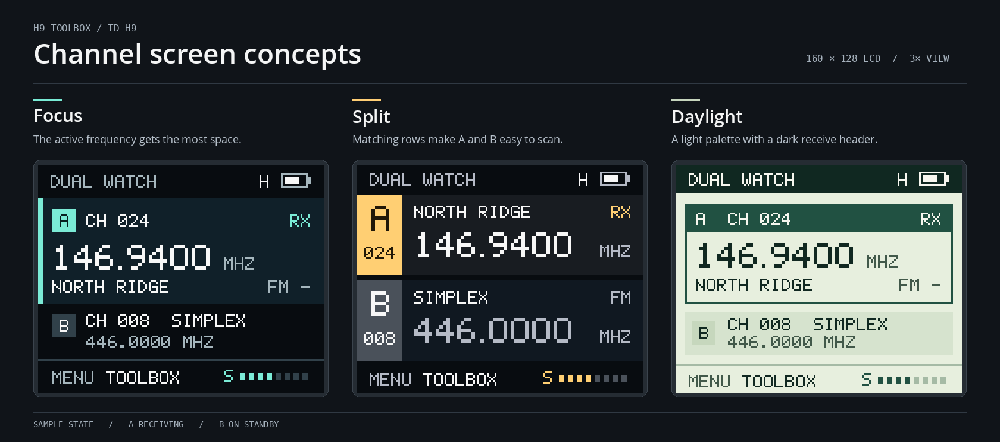

# TD-H9 channel screen concepts

These static mockups show the TD-H9’s 160 × 128 display with channel A
receiving and channel B on standby. The **S** label marks the example
receive signal meter.

| Concept | Layout | 4× preview | 160 × 128 PNG |
| --- | --- | --- | --- |
| Focus | Large active frequency and a compact standby row | [Preview](focus.png) | [Native](focus-160x128.png) |
| Split | Matching rows for channels A and B | [Preview](split.png) | [Native](split-160x128.png) |
| Daylight | Light palette and a dark active-channel header | [Preview](daylight.png) | [Native](daylight-160x128.png) |
| Focus Light | Light palette for the Focus layout | [Preview](focus-light.png) | [Native](focus-light-160x128.png) |
| Daylight Dark | Dark palette for the Daylight layout | [Preview](daylight-dark.png) | [Native](daylight-dark-160x128.png) |
